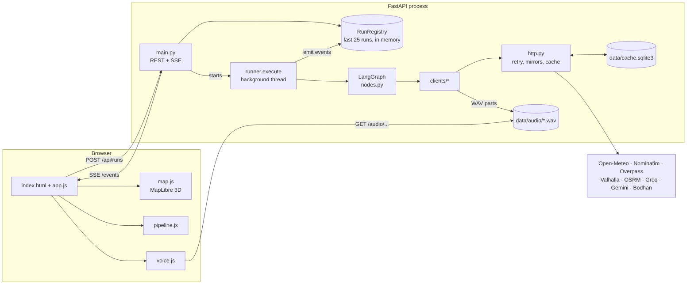
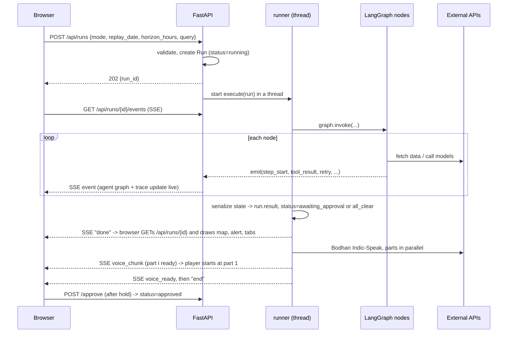
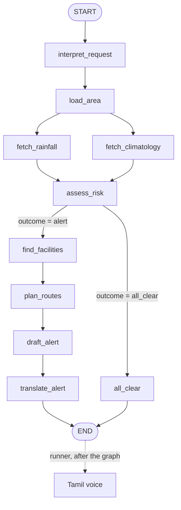

# How Chennai Flood Agent works

This is the guide for the team: what happens from the moment someone presses **Deploy agent** to
the Tamil voice playing, why each piece is built the way it is, and where to change things. The
[README](README.md) covers how to run the app; this file covers how it works.

**Contents**

1. [The idea in one minute](#1-the-idea-in-one-minute)
2. [Repository map](#2-repository-map)
3. [System overview](#3-system-overview)
4. [Life of a run](#4-life-of-a-run)
5. [The agent graph, node by node](#5-the-agent-graph-node-by-node)
6. [The risk model](#6-the-risk-model)
7. [Routing around flooded areas](#7-routing-around-flooded-areas)
8. [The alert: LLM, fact check, Tamil, voice](#8-the-alert-llm-fact-check-tamil-voice)
9. [Events and live streaming](#9-events-and-live-streaming)
10. [Talking to external APIs: retries, mirrors, cache](#10-talking-to-external-apis-retries-mirrors-cache)
11. [HTTP API reference](#11-http-api-reference)
12. [The frontend](#12-the-frontend)
13. [Configuration](#13-configuration)
14. [Testing and debugging](#14-testing-and-debugging)
15. [How to change common things](#15-how-to-change-common-things)
16. [Limits and gotchas](#16-limits-and-gotchas)

---

## 1. The idea in one minute

Chennai floods every north-east monsoon, and warnings usually arrive as a city-wide "heavy rain
expected". This agent turns the same forecast into something a disaster officer can act on:

- **Where:** it splits Greater Chennai into 65 cells of about 2.8 km and scores each one's flood risk
  from the forecast rainfall, how extreme that rain is *for Chennai*, and how low-lying the cell is.
- **Who is exposed:** it finds the hospitals, clinics, care homes, schools, colleges, shelters, police
  and fire stations inside the high-risk cells.
- **How to get out:** it plans driving routes from those buildings to relief sites in safer cells,
  steering around the flooded cells, and can do the same for any point a resident gives.
- **What to tell people:** an LLM drafts an alert from verified facts only, a checker rejects any
  number it cannot trace to the data, and IIT Madras's Bodhan models translate it to Tamil and speak
  it.
- **Who decides:** nothing is released until the officer holds **Approve**.

Every number comes from a live public API (Open-Meteo, OpenStreetMap, Valhalla). There is no
mock data anywhere; the cache only stores real responses.

---

## 2. Repository map

```
Chennai-Flood-Agent/
├── run.bat                     Windows launcher: venv, packages, .env, port check, start, open browser
├── README.md                   how to run it
├── ARCHITECTURE.md             this file
├── .env.example                template for API keys (committed; real keys go in .env, which is not)
├── Procfile                    start command for Heroku-style hosts
├── backend/
│   ├── requirements.txt
│   ├── app/
│   │   ├── main.py             FastAPI app: HTTP endpoints, SSE stream, static frontend
│   │   ├── config.py           settings from environment / .env, helpline numbers
│   │   ├── events.py           Run objects, run registry, emit()/bind()/step() trace helpers
│   │   ├── http.py             fetch_json / fetch_bytes: retries, mirrors, backoff, cache, throttle
│   │   ├── cache.py            SQLite response cache (data/cache.sqlite3)
│   │   ├── geo.py              grid cells, distances, km-accurate lengths and buffers
│   │   ├── risk.py             the flood-risk model (pure functions, unit tested)
│   │   ├── guardrails.py       fact check for the English alert and the Tamil translation
│   │   ├── agent/
│   │   │   ├── state.py        FloodState: the dict that flows through the graph
│   │   │   ├── graph.py        LangGraph wiring: nodes, edges, the branch
│   │   │   ├── nodes.py        every graph node
│   │   │   ├── runner.py       runs the graph, then the voice; turns state into API JSON; exports
│   │   │   └── safe_route.py   on-demand route for one person after a run
│   │   └── clients/            one module per external service
│   │       ├── openmeteo.py    forecast, archived forecasts (replay), ERA5 climatology, elevation
│   │       ├── osm.py          Nominatim (boundary, geocoding, place names), Overpass (buildings)
│   │       ├── routing.py      Valhalla block-and-reroute loop, OSRM fallback
│   │       ├── llm.py          Groq, then Gemini, JSON mode
│   │       ├── bodhan.py       Bodhan Indic-Translate and Indic-Speak
│   │       └── telegram.py     dormant: posts approved alerts if configured
│   ├── scripts/smoke_run.py    one full run from the command line, trace printed
│   └── tests/                  unit tests for risk scoring, guardrails and focus areas
├── frontend/                   plain ES modules, no build step
│   ├── index.html              layout
│   ├── styles.css              dark "command centre" theme, three responsive layouts
│   ├── app.js                  wires everything: form, SSE, panels, tabs, approve, downloads
│   ├── map.js                  MapLibre 3D map: risk columns, buildings, routes, popups
│   ├── pipeline.js             live agent-graph view
│   ├── voice.js                progressive Tamil voice player with waveform
│   └── chart.js                hourly rainfall chart that drives the time-lapse
└── data/                       created at runtime, not committed: cache.sqlite3, audio/
```

---

## 3. System overview



One Python process serves everything: the JSON API, the live event stream and the static frontend.
There is no separate database server and no build step, which keeps deployment to one command.

Key decisions:

- **The graph runs in a background thread.** `POST /api/runs` returns a run id immediately (HTTP
  202), and the browser follows progress over Server-Sent Events. A run can take 5–60 seconds, and
  an HTTP request should not hang that long.
- **Runs live in memory.** `RunRegistry` keeps the last 25 runs. A restart forgets them, which is
  fine for a demo and avoids a database.
- **API responses live on disk.** Every external response goes into SQLite with its fetch time. This
  makes repeat runs fast, keeps us within the public servers' fair-use limits, and lets the agent
  keep working from the last good copy when a server is down.

---

## 4. Life of a run



Step by step:

1. **Request.** `main.py` validates the body with Pydantic (`RunRequest`). Replay dates must fall
   between 2022-01-01 (start of Open-Meteo's archived-forecast record) and three days ago.
2. **Run object.** `registry.create()` makes a `Run` with an id, an empty event list and
   `status="running"`.
3. **Graph.** `runner.execute(run)` binds the run as the current context (so any code can call
   `emit()`), then calls `graph.invoke()`. Each node updates the shared state and emits events as it
   goes.
4. **Result.** The final state is kept on `run.state` (for later route questions) and converted
   to JSON by `serialize()` into `run.result`. The status becomes `awaiting_approval` if anything is
   high risk, else `all_clear`, and a `done` event is emitted.
5. **Voice.** If there is a checked Tamil alert and a TTS key, the runner generates speech in parts
   and emits each part as it lands. Only then is `run.finished` set, which ends the SSE stream.
6. **Follow-ups.** The officer can download buildings, ask for safe routes and approve, all against
   the same run id.

---

## 5. The agent graph, node by node



The wiring is in [graph.py](backend/app/agent/graph.py). `fetch_rainfall` and `fetch_climatology`
both start after `load_area` and run in the same LangGraph superstep (in parallel); `assess_risk`
waits for both. After `assess_risk`, `route_after_assessment` reads `state["outcome"]` and picks a
branch.

Every node is wrapped by the `@node(name, title)` decorator in [nodes.py](backend/app/agent/nodes.py).
It binds the run's event log for the node's thread and wraps the body in `step()`, which emits
`step_start` / `step_end` (or `step_error`). Nodes therefore only contain their own logic and call
`emit()` for anything worth showing.

### State

`FloodState` ([state.py](backend/app/agent/state.py)) is a `TypedDict`. Each node returns only the
keys it changes, and LangGraph merges them.

| Key | Set by | What it holds |
|---|---|---|
| `request` | caller | mode, replay date, horizon, free-text query |
| `horizon_hours`, `replay_date`, `focus` | interpret_request | look-ahead (24/48/72), replay date or None, focus circle `{name, lat, lon, radius_km}` or None |
| `boundary`, `cells`, `elevations` | load_area | city polygon, list of `Cell`, mean elevation per cell |
| `rain` | fetch_rainfall | `RainSeries`: hourly times and mm per hour per cell |
| `climatology` | fetch_climatology | `Climatology` per anchor point |
| `risks`, `localities`, `outcome` | assess_risk | `CellRisk` per cell, place names of the worst cells, `alert` or `all_clear` |
| `facilities_at_risk`, `shelters` | find_facilities | buildings in high-risk cells; every possible relief site |
| `routes` | plan_routes | evacuation routes |
| `facts`, `alert` | draft_alert, translate_alert, all_clear | the facts given to the LLM, and the alert in English and Tamil |
| `sources` | every data node | provenance of each API used; has an `operator.add` reducer so parallel nodes can both append |

### interpret_request

Turns the officer's optional free text into parameters.

- If there is a query, the LLM gets `INTERPRET_SYSTEM` and must reply with JSON
  `{"focus_places": [...], "horizon_hours": 24|48|72|null, "reasoning": "..."}`.
- Each place is geocoded inside Chennai's bounding box (Nominatim, `bounded=1`), so "Velachery"
  can never resolve to a Velachery elsewhere. Places that are not found are reported and skipped.
- `_focus_around()` builds one focus circle around everything found: centred between the places,
  with radius `max(6 km, farthest place + 3 km)`. Cells outside the circle are still scored and drawn,
  but only cells inside it count for alerts, buildings and routes (`CellRisk.in_focus`).
- No query, no LLM key or no place found means the whole city and the horizon from the form.

### load_area

- **Boundary:** Nominatim polygon for "Chennai, Tamil Nadu, India", cached 30 days.
- **Grid:** `build_grid()` lays 0.025° squares (about 2.8 km) over the bounding box
  `(12.85, 80.13) – (13.24, 80.34)` and keeps a square if at least 30% of it is inside the
  boundary. That gives **65 cells**, with ids like `r4c3` (row 4, column 3 from the south-west).
- **Terrain:** 5 points per cell (centre plus four inner points) are sent to the Open-Meteo
  Elevation API (Copernicus 90 m DEM), 100 points per call. The cell's elevation is their mean.
  Averaging 5 samples stops one odd pixel (a flyover, a lake) from deciding a cell's terrain.

### fetch_rainfall

- **Live:** Open-Meteo Forecast API, hourly `precipitation` for all 65 cell centres in one call,
  cached 15 minutes. The window starts at the current hour in IST.
- **Replay:** Open-Meteo Historical Forecast API, which serves *what the weather models forecast at
  the time*, not what actually fell. The window starts at 00:00 on the replay date. The agent sees
  exactly what forecasters saw, which makes the replay an honest test.
- Missing hourly values are counted as 0 mm and reported as a warning with the percentage missing.

### fetch_climatology

What counts as "a lot of rain" depends on the place, so the agent asks how extreme this rain is
*for Chennai*:

- 4 anchor points across the city, ERA5 reanalysis daily rainfall, 2005–2024 (20 years), one call,
  cached forever since the past does not change.
- For each anchor: the wettest day of each year and the wettest 3 days of each year. The **median**
  of those 20 annual maxima is the **2-year return level**: rain that heavy happens about every
  other year.
- ERA5 cells are about 25 km, so more anchors would just repeat the same ERA5 cell. In practice two
  of our four anchors return identical numbers for that reason.

Actual values: 2-year wettest day **81–89 mm**, 2-year wettest 3 days **148–161 mm**, record day
**196–256 mm**.

### assess_risk

Runs the risk model (next section) for every cell, then:

- counts cells by level,
- names up to `MAX_NAMED_LOCALITIES` (6) of the worst high-risk cells with Nominatim reverse
  geocoding, e.g. "Zone 14 Perungudi",
- sets `outcome = "alert"` if any in-focus cell is high or severe, otherwise `"all_clear"`, and emits
  that decision.

### find_facilities

- Loads critical buildings from OpenStreetMap through Overpass, as **4 separate queries**: health
  (hospital, clinic, care homes), education (school, college, university), shelter (community
  centre, social shelter, assembly point), and emergency services (police, fire station). Each is
  cached 30 days on its own. Public Overpass servers are often overloaded; splitting means one
  failing group only loses that group, and the trace says which.
- Each building is assigned to a grid cell by arithmetic (`_cell_id_at`): no geometry test needed.
- **At risk** = in a high or severe cell that is inside the focus area. Each one carries its cell's
  level, score, locality, rain figures and elevation, plus OSM address and phone where tagged.
- **Possible relief sites** = every shelter, school and college, wherever it is; `plan_routes`
  picks the safe ones.
- Sorted by kind priority (hospital, care home, clinic, shelter, school, college, police, fire
  station), named before unnamed, then by score.

### plan_routes

- **Relief sites** are possible sites in low or moderate cells. If there are none (Cyclone Michaung
  makes every cell severe), `_relief_sites()` falls back to the **least-affected fifth** of the city
  by score, and only cells worse than that cut-off are avoided.
- For the top `MAX_ROUTES` (5) at-risk buildings: candidates are relief sites at least 1.5 km away,
  named sites first ("Unnamed school" is not actionable), nearest first. It tries up to 2
  candidates and keeps the first that routes.
- Routing itself is the block-and-reroute loop in section 7.

### draft_alert

- `_facts()` builds a compact JSON of verified facts: forecast window, focus area, the 5 worst areas
  with rain and IMD category, cell counts by level, buildings at risk by kind, the evacuation routes,
  and the official helplines (1913, 1070, 112).
- The LLM writes `headline_en`, `body_en` and `actions_en` from those facts only.
- `check_alert()` verifies it (section 8). A rejected draft goes back with the problems listed, up to
  3 drafts. If all fail, or no LLM is configured, `_template_alert()` writes a deterministic alert
  from the same facts.

### translate_alert

- Translates the headline, the body and each action separately with Bodhan Indic-Translate, 3 at a
  time.
- `check_translation()` checks each part. **All or nothing:** if any part fails, the whole alert stays
  English-only, because a half-translated alert is worse than a clear English one.

### all_clear

Used when nothing is high risk. It reports the wettest 24 hours anywhere in the focus area with its
IMD category, and the graph ends. No buildings, routes, alert or voice.

### After the graph: the voice

Not a graph node, because it should not delay the result. The officer sees the map and the alert as
soon as the graph ends, and the voice streams in afterwards (section 8).

---

## 6. The risk model

All in [risk.py](backend/app/risk.py), pure functions with unit tests.

For each cell:

```
r24              = wettest 24 consecutive hours in the window   (rolling sum over hourly rain)
total            = all rain in the window (24, 48 or 72 h)
rain_index       = max( r24 / two_year_1d ,  total / two_year_3d )
lowness          = 0 for the highest cell in the city ... 1 for the lowest (by rank)
terrain_factor   = 0.7 + 0.6 × lowness                          (0.7 ... 1.3)
score            = rain_index × terrain_factor
```

`two_year_1d` and `two_year_3d` come from the nearest climatology anchor.

**Level from score:** severe ≥ 1.6, high ≥ 1.0, moderate ≥ 0.5, else low.

**Then two official-category rules,** using IMD's 24-hour rainfall categories (heavy ≥ 64.5 mm,
very heavy ≥ 115.6 mm, extremely heavy ≥ 204.5 mm):

- **Cap:** if `r24` is below IMD "heavy" *and* the multi-day ratio `total / two_year_3d` is below 1,
  the level is at most moderate. Light rain on low ground is not a flood warning.
- **Floor:** IMD "very heavy" is never shown below high; "extremely heavy" never below severe;
  "heavy" never below moderate. The map never contradicts an official IMD warning.

**Why this design:**

- **Relative, not absolute.** 100 mm means something different in Chennai and in Cherrapunji.
  Dividing by Chennai's own 2-year level makes "1.0" mean "as bad as the heaviest day of a
  typical year", whatever the city.
- **Two time scales.** `max(...)` catches both a cloudburst (one huge day) and a soaking (three
  steady days that fill drains), which is how Chennai often floods.
- **Rank-based lowness.** The DEM has noise of a few metres, and Chennai's whole range is only
  about 2–22 m. Ranking is robust to that noise; absolute heights would let one bad pixel dominate.
- **An earlier version** compared rain with the 99th percentile of all days (about 40 mm), which
  flagged ordinary 52 mm days as high risk. The 2-year level (about 88 mm) and the IMD cap fixed
  that.

**Worked example: 1 Nov 2022 replay, cell `r4c3` (Zone 14 Perungudi):**

| | value |
|---|---|
| wettest 24 h (`r24`) | 134.4 mm → IMD "very heavy" |
| 72 h total | 181.7 mm |
| nearest anchor's 2-year day / 3 days | 87.5 mm / 161.2 mm |
| ratios | 134.4 / 87.5 = **1.54**, 181.7 / 161.2 = 1.13 → `rain_index` = 1.54 |
| elevation, lowness | 4.2 m, 0.83 → `terrain_factor` = 0.7 + 0.6 × 0.83 = **1.20** |
| score | 1.54 × 1.20 = **1.84** → **severe** (≥ 1.6) |

For contrast, the lowest-scoring cell that day (`r12c2`, in the north at 16.4 m) had 69.2 mm in 24 h
(IMD "heavy"): ratio 0.85 × terrain 0.75 = 0.64, which is **moderate**. The "heavy" floor also
keeps it at moderate.

That day overall: 8 severe, 27 high, 30 moderate.

**Honest limitation:** forecast models are 9–25 km resolution, so neighbouring cells often get
the same rain. Differences inside the city come mostly from terrain. The README says so.

---

## 7. Routing around flooded areas

[routing.py](backend/app/clients/routing.py) uses FOSSGIS's public Valhalla server (no key) and the
public OSRM server as a fallback.

**The problem:** routers don't know about our flood map. Valhalla can avoid areas, but its
`exclude_polygons` option has a 10 km total-perimeter limit, far too small for a city of flooded
cells. It also accepts `exclude_locations`: up to 50 points, each marking the road at that point as
closed.

**The block-and-reroute loop** (`plan_route`):

```
zone = union of hazard cells − 0.6 km circles around start and end
         (a hospital inside a flooded cell has to drive through its own cell to leave)
best = none, blocked = []
repeat up to 4 times (1 plain attempt + 3 reroutes):
    route = Valhalla(start, end, exclude_locations = blocked)
    overlap = km of the route inside zone
    keep route if (overlap, distance) beats best
    stop if overlap = 0, or no points inside the zone, or 50 points already blocked
    blocked += 12 route points spread evenly along the part inside the zone
if Valhalla never answered: OSRM shortest route, overlap measured and reported
```

- **Lengths** are measured in km after scaling degrees by latitude (`geo.length_km`), so diagonal
  segments aren't distorted.
- **Fair use:** a 1.1-second `Throttle` keeps us at about one Valhalla request per second, and
  responses are cached 24 hours, keyed by a hash of the request body.
- **Honesty:** the UI shows overlap that remains. On 1 Nov 2022 the hospitals sit deep inside
  severe cells, so every route out crosses some risk area. The loop cuts it (e.g. 4.8 km → 4.5 km,
  6.2 km → 3.1 km) and the UI says "still crosses 3.1 km of high-risk cells" rather than hiding it.
  Every attempt is recorded in `route.attempts` and shown in the Safe routes panel.

**Safe route for anyone** ([safe_route.py](backend/app/agent/safe_route.py),
`POST /api/runs/{id}/route`):

- The start point is a place name (geocoded inside Chennai), a map click or the browser's location.
- It uses the run's own hazard cells and relief sites (`run.state`), so the answer matches the map.
- It considers the 6 nearest relief sites, prefers named ones, routes to the best 2, and returns
  the route with the least overlap, then the shortest time. It also reports the risk level of the
  cell you start in.

---

## 8. The alert: LLM, fact check, Tamil, voice

### LLM ([llm.py](backend/app/clients/llm.py))

- **Providers in order:** Groq (`GROQ_MODEL`, default `openai/gpt-oss-120b`), then Gemini
  (`GEMINI_MODEL`, default `gemini-3.5-flash`). Both use JSON mode, so the reply is always
  parseable JSON. If one fails, the trace says so and the next is tried.
- **What the LLM does:** (a) turns the free-text request into parameters, (b) writes the English
  alert. It never decides risk levels, routes or numbers. Those are computed.
- **Model retirement:** model names do get retired (this happened to `llama-3.3-70b-versatile` and
  `gemini-2.5-flash`). If the trace shows HTTP 404 for an LLM, pick a current model from the
  provider's model list (Groq console, Google AI Studio) and set `GROQ_MODEL` / `GEMINI_MODEL` in
  `.env`.

### Fact check ([guardrails.py](backend/app/guardrails.py))

LLMs invent plausible numbers ("up to 150 mm", a wrong helpline). `check_alert()`:

1. extracts every number in the headline, body and actions,
2. normalises them (`1,913` → `1913`, `134.0` → `134`),
3. collects every number in the facts, both rounded to an integer and to one decimal, so "134 mm"
   matches a fact of 134.4,
4. rejects the draft if any alert number is not in the facts, and lists them.

The rejection goes back to the model as feedback ("numbers not present in the facts: 150") for up
to 3 drafts in total. After that the deterministic template is used, so an alert always comes out.

### Tamil translation ([bodhan.py](backend/app/clients/bodhan.py))

- **Model:** Bodhan's `indic-translate` via its OpenAI-style `/v1/chat/completions` endpoint, with
  the prompt format from the model card: `Translate the following text into Tamil:\n<text>`.
  Temperature 0, results cached by text hash, and `finish_reason == "length"` (cut off) is treated as
  a failure.
- **Why not have the LLM write Tamil?** General LLMs write noticeably weaker Tamil than a model
  trained for Indian languages.

`check_translation()` requires:

- Tamil script to be present,
- the same set of numbers as the English. Python's `\d` also matches Tamil digits (௧௩௪), so a
  translation using either digit style passes.

A dropped helpline or a changed rainfall figure fails the check.

### Tamil voice (streamed)

- **Model:** Bodhan's `indic-speak` (`POST /v1/audio/speech`, voice `Anitha` by default), which
  returns WAV (16-bit mono, 24 kHz).
- **Chunking:** the model card recommends short inputs, so `_chunks()` splits the text at sentence
  ends into parts of at most 250 characters. The headline, the body and each action never share a
  part, so **part 1 is the short headline** and comes back first.
- **Parallel synthesis:** parts are made 6 at a time (Bodhan allows 10 parallel requests per key).
  Each part is saved as `data/audio/<hash>-<i>.wav` as soon as it lands, and an event
  `voice_chunk {index, total, url}` goes to the browser.
- **Playback:** the browser player (`voice.js`) starts part 1 at once and moves to the next part
  when one ends, waiting if the next is not ready yet. Measured: part 1 in about 4 s, all 8–9 parts
  in about 20 s.
- **Full file:** once all parts are in, they are joined into `data/audio/<hash>.wav` for download.
- **Caching:** the hash covers voice, language and text, so the same alert never costs credits twice.

### Approval

`POST /approve` only works when the run is `awaiting_approval`. It records the time, emits
`approved`, and (only if both Telegram settings exist) posts the English and Tamil text. The
press-and-hold button in the UI is deliberate friction: a stray click must never release a public
alert.

---

## 9. Events and live streaming

[events.py](backend/app/events.py) is what makes the agent visible.

- **`Run`:** id, request, status, result, `state` (final graph state), an append-only `events` list
  and a `finished` flag.
- **`emit(type, message, **data)`:** appends an event to *the current run*, found through a
  `ContextVar`. Tool code deep inside `http.py` or `routing.py` can report a retry without being
  passed the run.
- **`bind(run)`:** sets the current run for a block of code. The node decorator does this, because
  LangGraph may run nodes in different threads.
- **`step(name, title)`:** sets the current step and emits `step_start`, then `step_end` with
  `duration_ms`, or `step_error`.
- **Threads:** worker threads don't inherit context variables, so `translate_alert` uses
  `contextvars.copy_context().run(...)` to carry the run into its pool.

**The SSE endpoint** (`GET /api/runs/{id}/events`):

- polls the event list every 0.25 s and sends new events as `id: <seq>` + `data: <json>`,
- ends with `event: end` once `run.finished` is set and everything is sent,
- supports `Last-Event-ID`, so a browser that reconnects resumes where it left off with nothing lost
  or repeated.

**Event types:**

| type | meaning |
|---|---|
| `run_start` | run began |
| `step_start` / `step_end` / `step_error` | a graph node started / finished (with duration) / failed |
| `reasoning` | the agent explaining what it's doing (plan, counts) |
| `decision` | a branch choice (alert vs all clear) |
| `tool_result` | an outcome from a tool (cells loaded, routes found, voice generated) |
| `retry` | an API retry, mirror switch, LLM fallback or a reroute |
| `warning` | something degraded but the run continues (stale cache, missing data, English-only) |
| `guardrail` | fact-check or translation-check result |
| `done` | graph finished; `data.status` is `awaiting_approval` or `all_clear` |
| `voice_start` / `voice_chunk` / `voice_ready` | Tamil voice progress |
| `approved` | officer approved |
| `failed` | a required source was unreachable; the run stopped |

---

## 10. Talking to external APIs: retries, mirrors, cache

All outbound calls go through [http.py](backend/app/http.py).

`fetch_json(source, urls, ..., cache_key, ttl, retries, throttle)`:

1. If there is a cached copy younger than `ttl` (or `ttl=None`, meaning it never expires), return
   it with no network call.
2. Otherwise try each URL in `urls` (mirrors), each up to `retries + 1` times:
   - 200 → store in the cache and return.
   - 4xx other than 429 → raise `ToolError` at once. A bad request will not get better with retries.
   - 429 or 5xx or a network error → wait and retry. The wait honours `Retry-After` (capped at 30 s),
     else 5 s, 10 s, 15 s… for rate limits and 1.5 s, 3 s… for other errors. Each retry is emitted.
3. If everything failed but an older cached copy exists, return it marked **stale**. The UI labels
   that source "stale cache" with its time.
4. Otherwise raise `ToolError`. Nodes decide whether that is fatal (no rainfall → run fails) or
   degradable (no buildings → continue with a warning).

`fetch_bytes()` is the same retry logic for audio, without the cache.

**What is cached, and for how long:**

| Data | Cache | Why |
|---|---|---|
| City boundary, geocoding | 30 days | rarely changes |
| Reverse geocoded place names, elevation, ERA5 climatology, archived forecasts | forever | the past and the terrain don't change |
| Buildings (each Overpass group) | 30 days | OSM changes slowly; Overpass is often overloaded |
| Live forecast | 15 minutes | forecasts update hourly |
| Valhalla routes | 24 hours | roads don't change daily |
| Bodhan translations | forever, by text hash | same text, same translation |
| Bodhan audio | forever, as files | same text, same audio |

The cache is `data/cache.sqlite3`. Delete the `data/` folder to start fresh. The next runs will be
slower while it refills.

**Fair use:** Nominatim and Valhalla each have a `Throttle(1.1)`, at most about one request per
second, as their usage policies ask. Every request sends `USER_AGENT`.

---

## 11. HTTP API reference

All paths are under the same host as the UI.

**`GET /api/health`** → which optional services are configured.

```json
{"status": "ok", "app_name": "Chennai Flood Agent",
 "llm_providers": ["groq:openai/gpt-oss-120b", "gemini:gemini-3.5-flash"],
 "routing": "Valhalla (avoids risk cells) + OSRM fallback",
 "tamil_translation": true, "tamil_speech": true, "telegram": false,
 "replay_range": ["2022-01-01", "2026-10-29"]}
```

**`POST /api/runs`** → `202 {"run_id": "8ebc06b7bd93"}`

```json
{"mode": "replay", "replay_date": "2022-11-01", "horizon_hours": 72,
 "query": "Check Adyar and Velachery for the next 48 hours"}
```

`mode` is `live` or `replay`; `horizon_hours` is 24, 48 or 72; `query` is optional (≤ 300 chars).

**`GET /api/runs/{id}/events`** → Server-Sent Events stream (section 9).

**`GET /api/runs/{id}`** → `{id, status, request, result}`. The main `result` fields:

| field | content |
|---|---|
| `outcome` | `alert` or `all_clear` |
| `window` | `{start, end, hours}` in IST |
| `focus` | focus circle or null |
| `boundary` | GeoJSON geometry of the city |
| `cells` | GeoJSON FeatureCollection; each feature's properties are a `CellRisk` plus `locality` |
| `rain_hourly` | `{times, by_cell: {cell_id: [mm per hour]}}` for the time-lapse |
| `facilities_at_risk` | buildings: name, kind, level, score, locality, address, phone, rain, elevation, lat/lon |
| `routes` | `{from, to, coords: [[lat, lon]...], distance_km, duration_min, provider, hazard_overlap_km, blocked_points, attempts}` |
| `alert` | `headline_en/body_en/actions_en`, Tamil `_ta` versions if checked, `generated_by`, `guardrail`, `translation` |
| `audio` | `{status: generating, ready or failed, chunks: [urls], url}` |
| `facts` | the facts the alert was written from |
| `sources` | latest provenance per source: `{source, fetched_at, from_cache, stale}` |

**`POST /api/runs/{id}/route`** with `{"place": "Velachery"}` or `{"lat": 12.98, "lon": 80.22}` →
a route object like those above, plus `from.level`, `to.address/phone/locality` and
`sites_considered`. Errors: 409 if the run had no high risk, 404 if the place is not found, 400 if
the point is outside Chennai, 502 if routing failed.

**`GET /api/runs/{id}/buildings.csv`**, **`.../buildings.geojson`** → file downloads. CSV columns:
`name, kind, level, score, locality, address, phone, rain_24h_max_mm, rain_total_mm, imd_category,
elevation_m, lat, lon, osm_url`. The CSV starts with a byte-order mark so Excel shows Tamil names
correctly.

**`POST /api/runs/{id}/approve`** → `{status: "approved", approved_at, telegram_message_ids}`; 409
unless the run is `awaiting_approval`.

**`POST /api/runs/{id}/speech`** → `{url}`. Regenerates the voice if the automatic attempt failed.

**`GET /audio/<file>.wav`** → voice files. **`GET /`** → the UI.

---

## 12. The frontend

Plain JavaScript modules served as static files: no framework, no bundler, nothing to build.
Libraries come from CDNs: MapLibre GL 4.7.1 (cdnjs) and Google Fonts (Space Grotesk,
JetBrains Mono, Noto Sans Tamil). The basemap is OpenFreeMap's dark style, which needs no key.

| Module | Role |
|---|---|
| `app.js` | Entry point. Loads `/api/health`, handles the form and scenario buttons, opens the SSE stream, routes each event to the right component, renders the result panels, approve, downloads, safe routes. |
| `pipeline.js` | The agent graph on the left. Maps `step_start/step_end/retry/voice_*` events onto node states (pending → active → done / error / skipped), shows the latest message, retry counts and timing, and reports progress for the top bar. |
| `map.js` | MapLibre map. Sources and layers for boundary, 3D risk columns (`fill-extrusion`), focus circle, buildings, routes (with marching-ants animation), relief sites, safe route and start point. Popups. `setHour(h)` recomputes column heights for the time-lapse. |
| `chart.js` | SVG hourly rainfall bars for the wettest cell, with city average in the tooltip. Clicking or dragging moves the playhead, which calls `map.setHour`. |
| `voice.js` | Progressive player: a list of part URLs filled in as `voice_chunk` events arrive; plays them in order; draws a waveform from a Web Audio `AnalyserNode`. |

**How a run looks in the UI:**

1. Submit → `POST /api/runs` → `startRun()` resets everything and opens `EventSource`.
2. Each event → appended to the trace and passed to the agent graph view.
3. `done` → fetch `/api/runs/{id}` → `renderResult()` draws the map, stats, chart, alert,
   buildings and routes, then plays the time-lapse once.
4. `voice_chunk` → `voice.addPart()`. Part 1 auto-plays if the toggle is on, which browsers allow
   because the user already clicked Deploy.
5. `end` → stream closed.

**Map design choices:**

- **Column height** is rain so far × 22 m per mm, so the time-lapse literally grows the flood.
  Columns fade as you zoom in so they don't hide the streets.
- **Risk colours** use a fixed status palette (green, amber, orange, red) and are always shown with
  a text label, never colour alone.
- **Buildings are told apart by shape**, not colour, because colour already means risk: a rounded
  square with a cross for health, a house for relief sites and schools, a diamond for police and
  fire. Below zoom 12 they are small dots so the routes stay visible.

**Layouts** (in `styles.css`):

| Width | Layout |
|---|---|
| > 1360 px | full-screen map with floating glass panels |
| 1100–1360 px | same, with narrower panels |
| 760–1100 px | two columns: controls left; map, timeline, results right |
| < 760 px | one column |

---

## 13. Configuration

All settings are environment variables, read once at start-up from the process environment or
`.env` in the project root ([config.py](backend/app/config.py)). **Restart the app after changing
`.env`.**

| Variable | Default | Purpose |
|---|---|---|
| `GROQ_API_KEY`, `GROQ_MODEL` | none, `openai/gpt-oss-120b` | first LLM |
| `GEMINI_API_KEY`, `GEMINI_MODEL` | none, `gemini-3.5-flash` | fallback LLM |
| `BODHAN_TRANSLATE_API_KEY` | none | Tamil translation |
| `BODHAN_TTS_API_KEY`, `BODHAN_VOICE` | none, `Anitha` | Tamil voice (`Arun` is the male voice) |
| `TELEGRAM_BOT_TOKEN`, `TELEGRAM_CHAT_ID` | none | on hold; post approved alerts |
| `USER_AGENT` | `chennai-flood-agent/0.1 (hackathon prototype)` | identifies us to OSM/FOSSGIS; add a contact |
| `APP_NAME` | Chennai Flood Agent | title in the UI |
| `GRID_STEP_DEG` | 0.025 | cell size in degrees (about 2.8 km) |
| `MAX_ROUTES` | 5 | evacuation routes planned per run |
| `MAX_NAMED_LOCALITIES` | 6 | worst cells named by reverse geocoding |
| `OVERPASS_URLS` | 3 public mirrors | comma-separated Overpass endpoints |
| `DATABASE_PATH`, `AUDIO_DIR` | `data/cache.sqlite3`, `data/audio` | storage locations |

Every key is optional. Missing keys degrade gracefully, and the top bar shows what is on.

---

## 14. Testing and debugging

- **Unit tests:** `python -m pytest backend/tests -q`. These cover the risk model (bands, IMD floor
  and cap, soaking rain), the English fact check, the Tamil check (lost, added and Tamil-digit
  numbers) and focus circles. No network needed.
- **Full run without the browser:** `python backend/scripts/smoke_run.py 2022-11-01 "check Velachery"`
  prints every event and the final alert. It calls real APIs, including Bodhan.
- **Watch the trace:** almost every problem shows up in the UI's trace or agent graph. Look for
  `retry` and `warning` lines.
- **Something stale or odd:** stop the app and delete `data/` to clear the cache.
- **An LLM keeps failing with 404:** the model was retired; change `GROQ_MODEL` / `GEMINI_MODEL`.
- **No buildings:** Overpass was down and nothing was cached yet. Try again in a minute; once one
  fetch works it is cached for 30 days.
- **Port 8000 busy:** `run.bat 8001`.
- **Check services:** http://localhost:8000/api/health.

---

## 15. How to change common things

- **Change the risk thresholds:** `SCORE_BANDS`, `IMD_CATEGORIES` and the terrain factor in
  `risk.py`. Update the tests in `backend/tests` too.
- **Smaller or bigger cells:** `GRID_STEP_DEG` in `.env`. Smaller cells mean more API points and more
  cells to draw; 0.025 gives 65 cells.
- **Add a building type:**
  1. add an Overpass filter to `FACILITY_GROUPS` in `osm.py`,
  2. map it in `_kind()` and add it to `FACILITY_KINDS` (its position sets the priority),
  3. add it to `KIND_GROUP` and `KIND_LABEL` in `frontend/map.js`.
  Changing a group's filters means its cache key should change too, or old cached data is used for
  30 days: either rename the group or delete `data/`.
- **Another language:** `bodhan.translate(text, language="Hindi")` and
  `bodhan.speak(segments, lang="hi")`. The translation check needs a script range for that language
  in `guardrails.py`. Then add fields like `headline_hi` in `translate_alert` and a tab in the UI.
- **Another city:** `city_query` and `bbox` in `config.py`, `HELPLINES`, and the map's centre and
  `maxBounds` in `map.js`. The risk model adapts on its own because it uses local climatology.
- **A new graph node:**
  1. write a function `fn(state) -> dict` decorated with `@node("name", "Title")` in `nodes.py`,
  2. add it and its edges in `graph.py`,
  3. add any new state keys to `FloodState`,
  4. add a step to `STEPS` in `frontend/pipeline.js` so it appears in the agent graph.
- **Change the LLM prompts:** `INTERPRET_SYSTEM` and `ALERT_SYSTEM` in `nodes.py`. Keep the "use
  only these facts" rule, since the fact check depends on it.

---

## 16. Limits and gotchas

- **Rain resolution:** forecast models are about 9–25 km, coarser than our cells. Terrain does most
  of the intra-city differentiation.
- **Hospital counts:** OSM tags some clinics as hospitals, so hospital counts are upper bounds.
  Ordinary homes are not included.
- **No flood modelling:** we score flood *risk* from rain, local extremes and terrain. There is no
  hydrological model of drains, rivers (Adyar, Cooum) or reservoir releases, which matter a lot in
  Chennai (2015). Adding reservoir release data would be the next big improvement.
- **Public servers:** Overpass, Nominatim, Valhalla and OSRM are free community servers with
  fair-use limits and occasional outages. The cache and retries cover most of it. Warm the cache
  before a demo.
- **Single process:** runs live in memory (last 25) and are lost on restart. Run one server
  process; several workers would each have their own runs.
- **Bodhan credit:** translation and speech use prepaid credit (₹10 free to start); check the
  balance in the Bodhan console. Cached text never costs twice.
- **Never commit `.env`.** It is git-ignored; `.env.example` is the template that is committed.
