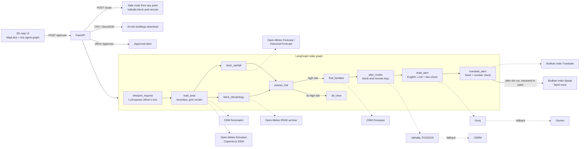

# Chennai Flood Agent

An autonomous agent that turns live rainfall forecasts into a 3D flood-risk map of Chennai, lists
every critical building inside high-risk areas (downloadable), plans evacuation routes that steer
around flooded cells, answers "how do I get to safety from here?" for any point in the city, and
drafts a fact-checked English alert. IIT Madras's Bodhan AI models translate it into Tamil and speak
it, streamed so the voice starts within seconds, and an officer approves the alert before release.

Every number comes from a live public API. Nothing is hardcoded or mocked.

## Architecture



### How risk is scored

For each ~2.8 km grid cell:

| Signal | Source | Use |
|---|---|---|
| Hourly rainfall for the next 24–72 h | Open-Meteo Forecast API | wettest 24 h and window total |
| Chennai's own rainfall extremes, 2005–2024 | ERA5 via Open-Meteo archive | 2-year return level: median of each year's wettest day / 3 days |
| Terrain | Copernicus DEM via Open-Meteo Elevation (5 samples per cell) | lower cells score higher |
| Official categories | IMD 24 h rainfall categories | floor and cap on the level |

`score = max(wettest 24 h / 2-year day, window total / 2-year 3 days) × (0.7 … 1.3 by lowness)`

Score bands: severe ≥ 1.6, high ≥ 1.0, moderate ≥ 0.5. IMD "very heavy" rain is never shown below
high, "extremely heavy" never below severe, and rain below IMD "heavy" is capped at moderate unless
the multi-day total alone beats the 2-year level. The rules live in
[backend/app/risk.py](backend/app/risk.py).

### What makes it agentic

- **Planning:** an LLM turns free text ("check Velachery for the next 48 hours") into a focus area
  and horizon, and the area is geocoded inside Chennai only.
- **Branching:** the graph skips facility and route work when nothing is high risk.
- **Parallel tools:** rainfall and climatology are fetched in the same step.
- **Self-correction:**
  - Every API call retries and switches mirrors (three Overpass servers).
  - If all live attempts fail, it falls back to the last cached copy, labelled stale in the UI.
  - Routing runs a block-and-reroute loop. It routes normally, finds the stretch that runs through risk cells, blocks road points there and routes again, up to 3 times within the server's 50-point limit. It keeps the route with the least km in risk cells, and if Valhalla is down it falls back to OSRM and reports the overlap.
  - If every cell is high risk, relief sites are taken from the least-affected fifth of the city.
- **Guardrails:**
  - Every number in the LLM's English alert must appear in the facts it was given, which catches invented rainfall figures or phone numbers.
  - A failed draft goes back to the model with the problems listed, up to three drafts in total, then a deterministic template is used.
  - The LLM writes English only. A dedicated Indic translation model, Bodhan Indic-Translate, produces the Tamil.
  - Each Tamil part must be in Tamil script and carry exactly the same numbers as its English source. If any part fails, the alert is published in English only rather than with an unchecked translation.
- **Human in the loop:** the alert is a draft until the officer presses and holds Approve.

### What the officer sees

- **3D risk map:** each 2.8 km cell is a column coloured by risk level. A rainfall time-lapse grows
  the columns hour by hour, so you can watch where the rain piles up.
- **Live agent graph:** each LangGraph node lights up as it runs, with its reasoning, retries and
  timing. The full trace streams below it.
- **Buildings at risk:** hospitals, clinics, care homes, schools, colleges, shelters, police and fire
  stations in high-risk cells, with address, phone and the rain expected there. Search and filter
  them, click one to fly to it, or download the list as CSV (opens in Excel) or GeoJSON (for QGIS
  and other GIS tools).
- **Safe routes:** type a place, click the map or use your location. The agent routes you to the
  nearest relief site through the same block-and-reroute loop and shows every attempt it made.
- **Tamil voice alert:** generated automatically after the run, in parallel parts. Part 1 is ready
  in a few seconds and starts playing while the rest are still being made.

## Setup

```bash
python -m pip install -r backend/requirements.txt
cp .env.example .env   # add keys; all are optional
python -m uvicorn app.main:app --app-dir backend --port 8000
```

Open http://localhost:8000. Routing needs no key. Without other keys the app still runs, with
template alerts in English only. Add keys to unlock each piece:

| Key | Source | Unlocks |
|---|---|---|
| `GROQ_API_KEY` | console.groq.com (free) | request parsing, LLM-written alerts |
| `GEMINI_API_KEY` | aistudio.google.com (free) | LLM fallback |
| `BODHAN_TRANSLATE_API_KEY` | console.bodhan.ai (₹10 free credit) | Tamil alert |
| `BODHAN_TTS_API_KEY` | console.bodhan.ai | Tamil voice alert |
| `TELEGRAM_BOT_TOKEN`, `TELEGRAM_CHAT_ID` | @BotFather | on hold: also posts approved alerts |

Command-line run without the UI:

```bash
python backend/scripts/smoke_run.py                 # live forecast
python backend/scripts/smoke_run.py 2022-11-01      # replay
python -m pytest backend/tests -q
```

## Replay mode

Live weather may be dry on demo day, so the same pipeline can run on Open-Meteo's archive of
past forecasts (2022 onwards). Useful dates:

| Date | Event | Result |
|---|---|---|
| 2022-11-01 | North-east monsoon onset, 134 mm | mixed: 8 severe, 27 high, 30 moderate |
| 2024-10-15 | Heavy rain red alert | 11 high, 54 moderate |
| 2024-11-30 | Cyclone Fengal, 189 mm | 50 severe, 15 high |
| 2023-12-03 | Cyclone Michaung, 258 mm | all severe |

## API

| Method | Path | Purpose |
|---|---|---|
| POST | `/api/runs` | start a run: `{mode, replay_date, horizon_hours, query}` |
| GET | `/api/runs/{id}/events` | live trace (Server-Sent Events, resumable) |
| GET | `/api/runs/{id}` | final result: cells GeoJSON, facilities, routes, alert, sources |
| POST | `/api/runs/{id}/approve` | officer approval (Telegram delivery on hold) |
| POST | `/api/runs/{id}/route` | safe route from `{place}` or `{lat, lon}` to the nearest relief site |
| GET | `/api/runs/{id}/buildings.csv` | at-risk buildings (CSV) |
| GET | `/api/runs/{id}/buildings.geojson` | at-risk buildings (GeoJSON) |
| POST | `/api/runs/{id}/speech` | retry the Tamil voice alert (normally generated automatically) |
| GET | `/api/health` | which optional services are configured |

## Deploy

One service serves both API and UI. `Procfile` works on Heroku (GitHub Student Pack credit); on any
host run `uvicorn app.main:app --app-dir backend --host 0.0.0.0 --port $PORT`. Use an always-on
plan so the demo never hits a cold start.

## Known limits

- Rainfall models are ~9–25 km resolution, so cell-to-cell differences inside the city come mostly
  from terrain, not rain.
- OSM tags many clinics as `amenity=hospital`, so hospital counts are upper bounds. Buildings
  come from OSM's tagged facilities; footprints of ordinary homes are not included.
- Public Overpass servers are often overloaded, so each building category is fetched and cached
  separately (30 days). A category that fails is reported in the trace rather than failing the run.
- The cache is a local SQLite file (`data/`), which resets when the host's disk is wiped.
